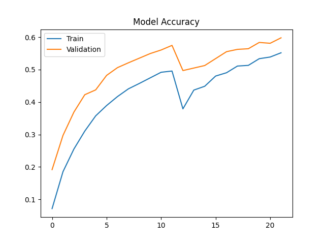
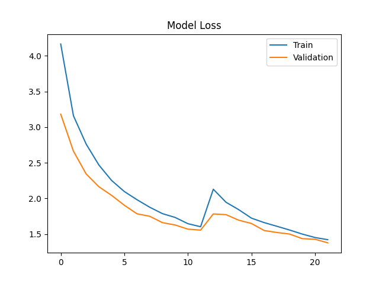
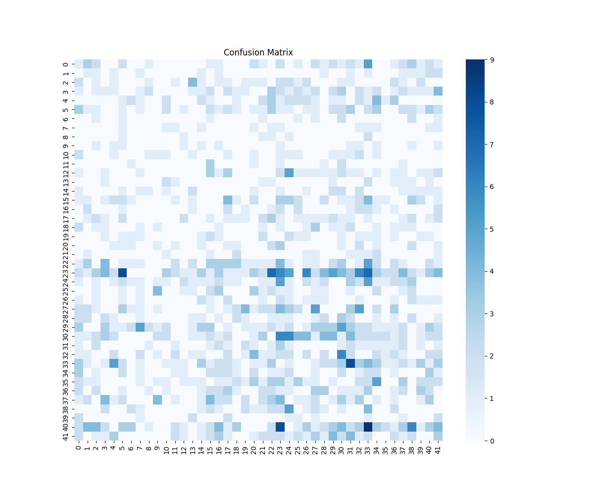

# 🌿 MedLeaf AI
### Intelligent Medicinal Plant Identification & AI-Powered Knowledge System

**MedLeaf AI** is a deep learning-based medicinal plant identification and knowledge system that combines **Computer Vision, Transfer Learning, Natural Language Processing, and Generative AI** to recognize medicinal plants from leaf images and provide structured information about their botanical characteristics and traditional therapeutic applications.

The system uses a **MobileNetV2-based Convolutional Neural Network (CNN)** to classify medicinal plant images across **42 plant categories**. It integrates a structured medicinal plant database with an **AI-powered herbal chatbot using Groq and the Llama 3.1 model**, allowing users to explore information about identified plants through natural-language interactions.

The application is developed using **Python, TensorFlow, Keras, Streamlit, Pandas, and Groq API**.

---

## 🎯 Project Objectives

- Develop an intelligent image classification system capable of identifying medicinal plants from leaf images.
- Implement deep learning using MobileNetV2 and transfer learning for plant recognition.
- Provide the top three predicted plant species along with confidence scores.
- Integrate a structured medicinal plant knowledge base containing scientific names, common names, plant parts, and therapeutic uses.
- Develop an AI-powered chatbot for interactive exploration of medicinal plant information.
- Provide an intuitive web interface using Streamlit.
- Visualize model performance through training accuracy, loss curves, and confusion matrices.

---

## ✨ Key Features

### 🔍 1. Medicinal Plant Identification

- Upload plant leaf images in JPG, JPEG, or PNG format.
- Automatically preprocess images to a resolution of 224 × 224 pixels.
- Classify images using a trained MobileNetV2-based CNN.
- Display the top three predicted medicinal plants.
- Show confidence percentages for each prediction.
- Retrieve relevant medicinal plant information from the integrated database.

### 🌱 2. Medicinal Plant Knowledge Base

After identifying a plant, the system retrieves:

- Scientific name
- Common name
- Plant parts used
- Recorded traditional therapeutic applications

The information is retrieved from a structured CSV database using Pandas.

### 💬 3. AI-Powered Herbal Chatbot

The application integrates the **Groq API with Llama 3.1 8B Instant** to provide interactive responses based on the identified plant.

The chatbot supports:

- Natural-language questions about the detected plant.
- Context-aware responses using available plant information.
- Information about recorded therapeutic uses.
- Explanations of plant parts and traditional preparation methods.
- Precautions and supporting explanations generated from the supplied plant context.
- Multiple chat sessions with options to create and clear conversations.

The chatbot uses plant information retrieved from the database as context for generating responses.

**Note:** AI-generated information is intended for educational purposes and should not be treated as medical advice.

### 📊 4. Admin Analytics Dashboard

The application includes an analytics dashboard displaying:

- Training and validation accuracy curves.
- Model confusion matrix.
- Total number of supported plant classes.
- Total medicinal plant knowledge records.

These visualizations help users understand the model's training performance and classification behavior.

---

## 🛠️ Technology Stack

| Category | Technologies |
|---|---|
| Programming Language | Python |
| Deep Learning | TensorFlow, Keras |
| Model Architecture | MobileNetV2, CNN |
| Machine Learning | Scikit-learn |
| Image Processing | Pillow, NumPy |
| Data Processing | Pandas, NumPy |
| Web Application | Streamlit |
| Generative AI | Groq API, Llama 3.1 |
| Visualization | Matplotlib, Seaborn |
| Data Storage | CSV, Excel, JSON |
| Development Tools | VS Code, Git, GitHub |
| Containerization | Docker |

---

## 🧠 Deep Learning Model Architecture

The medicinal plant classification model uses **MobileNetV2**, a lightweight convolutional neural network architecture designed for efficient image classification.

The project applies transfer learning by using MobileNetV2 pretrained on ImageNet as a feature extractor.

### Model Architecture

```text
Input Leaf Image (224 × 224 × 3)
              |
              v
       Image Preprocessing
       Resize + Normalize
              |
              v
    MobileNetV2 (ImageNet)
      Feature Extraction
              |
              v
    Global Average Pooling
              |
              v
       Batch Normalization
              |
              v
      Dense Layer (256)
      ReLU Activation
              |
              v
        Dropout (0.5)
              |
              v
      Dense Layer (42)
      Softmax Activation
              |
              v
       Plant Predictions
```

This architecture corresponds to the fine-tuning implementation in `src/train_fine.py`.

### Model Configuration

| Parameter | Configuration |
|---|---|
| Base Architecture | MobileNetV2 |
| Input Image Size | 224 × 224 × 3 |
| Pretrained Weights | ImageNet |
| Classification Classes | 42 |
| Batch Size | 32 |
| Optimizer | Adam |
| Loss Function | Categorical Cross-Entropy |
| Output Activation | Softmax |
| Initial Learning Rate | 0.0001 |
| Fine-Tuning Learning Rate | 0.00001 |
| Initial Training Epochs | Up to 12 |
| Fine-Tuning Epochs | Up to 10 |
| Validation Split | 20% |

The training pipeline uses early stopping, learning-rate reduction, model checkpointing, and class weighting.

---

## ⚙️ System Workflow

```text
              User
               |
               v
       Streamlit Web App
               |
               v
       Upload Leaf Image
               |
               v
        Image Processing
        (224 × 224 RGB)
               |
               v
        MobileNetV2 CNN
               |
               v
        Plant Classification
               |
               v
      Top 3 Predictions
      + Confidence Scores
               |
               v
     Medicinal Plant Database
               |
               v
       Plant Information
               |
               v
        AI Herbal Chatbot
         (Groq + Llama)
               |
               v
      Context-Aware Response
```

---

## 📁 Project Structure

```text
MedLeaf-AI/
│
├── data/
│   ├── plant_database.csv
│   ├── Medicinalplant.xlsx
│   ├── Medicinalplant_updated.xlsx
│   ├── Medicinalplant_updated_lowercase.xlsx
│   ├── data.xlsx
│   └── data_1.xlsx
│
├── models/
│   ├── best_model.keras
│   ├── class_indices.json
│   ├── accuracy_plot.png
│   ├── loss_plot.png
│   └── confusion_matrix.png
│
├── src/
│   ├── app_v4.py
│   ├── ai_module.py
│   ├── plant_advisor.py
│   ├── predict.py
│   ├── train.py
│   ├── train_fine.py
│   ├── utils.py
│   └── additional preprocessing scripts
│
├── .gitignore
├── Dockerfile
├── requirements.txt
└── README.md
```

**Dataset:** The original training dataset contains approximately 7,817 image files across 42 medicinal plant categories. It is excluded from this GitHub repository because of its size.

The pretrained model and class mapping are included, allowing inference without downloading the training images.

---

## 📊 Model Performance and Evaluation

The project generates model evaluation visualizations to analyze learning behavior and classification performance.

### Training and Validation Accuracy



The accuracy plot visualizes the training and validation accuracy across epochs.

### Training and Validation Loss



The loss plot illustrates the changes in training and validation loss during model optimization.

### Confusion Matrix



The confusion matrix provides a visual representation of classification performance across the medicinal plant categories.

The repository contains these evaluation artifacts. Exact accuracy, precision, recall, and F1-score values should be reported only after verifying them from a reproducible evaluation run.

---

## 🚀 Installation and Setup

### Prerequisites

- Python 3.11
- Git
- Conda or Python virtual environment
- Internet connection for Groq-powered chatbot functionality
- Groq API key

### Step 1: Clone the Repository

```bash
git clone https://github.com/SakshiCC/MedLeaf-AI.git
cd MedLeaf-AI
```

### Step 2: Create a Conda Environment

```bash
conda create -n medicinal_env python=3.11 -y
conda activate medicinal_env
```

Alternatively, use a Python virtual environment.

### Step 3: Install Dependencies

The current `requirements.txt` requires updating because several core dependencies are commented out and the Groq SDK is not listed.

For the current application, install the required packages:

```bash
python -m pip install streamlit==1.32.2 tensorflow==2.15.0 numpy==1.26.4 pandas==2.2.2 pillow==10.2.0 scikit-learn==1.3.2 matplotlib==3.8.4 seaborn python-dotenv==1.0.1 groq
```

The project also contains a `google-generativeai` dependency from an earlier configuration, but the current `app_v4.py` chatbot implementation uses Groq.

### Step 4: Configure the Groq API Key

Create a `.env` file in the project root directory:

```env
GROQ_API_KEY=your_groq_api_key_here
```

Obtain your API key from:

https://console.groq.com/

Never upload your `.env` file or API credentials to GitHub.

### Step 5: Run the Application

```bash
python -m streamlit run src/app_v4.py
```

After launching, open the local Streamlit URL displayed in your terminal, typically:

```text
http://localhost:8501
```

---

## 🖥️ How to Use

### Plant Detection

1. Open the Streamlit application.
2. Navigate to the **Plant Detection** tab.
3. Upload an image of a medicinal plant leaf.
4. View the top three predicted plant classes with confidence percentages.
5. Explore the scientific name, common name, plant parts, and recorded therapeutic uses.

### Admin Analytics

1. Open the **Admin Analytics** tab.
2. View the model accuracy graph.
3. Examine the confusion matrix.
4. Review the total number of supported plant classes and medicinal knowledge records.

### AI Chatbot

1. Identify a medicinal plant using the Plant Detection tab.
2. Navigate to the **AI Chatbot** tab.
3. Click **New Chat** in the sidebar.
4. Ask questions about the identified plant.
5. Receive AI-generated explanations based on the supplied plant information.

Chat sessions are maintained using Streamlit session state and are not permanently stored in a database.

---

## 🌿 Supported Medicinal Plants

The classification system supports **42 plant categories**, including:

- Neem (*Azadirachta indica*)
- Tulsi (*Ocimum tenuiflorum*)
- Mint (*Mentha*)
- Moringa (*Moringa oleifera*)
- Curry Leaf (*Murraya koenigii*)
- Hibiscus (*Hibiscus rosa-sinensis*)
- Mango (*Mangifera indica*)
- Guava (*Psidium guajava*)
- Jamun (*Syzygium cumini*)
- Bael (*Aegle marmelos*)
- Betel (*Piper betle*)
- Fenugreek (*Trigonella foenum-graecum*)
- Lemon (*Citrus limon*)
- Jackfruit (*Artocarpus heterophyllus*)
- Sandalwood (*Santalum album*)

The complete list of supported classes is available in `models/class_indices.json`.

---

## 🔬 Training Methodology

The model training process consists of the following stages:

**1. Dataset Preparation**

Plant images are organized into class-specific directories, with each directory representing one plant category.

**2. Image Preprocessing**

Images are resized to 224 × 224 pixels and normalized to the range [0, 1].

**3. Data Augmentation**

The training pipeline applies rotation, zooming, horizontal flipping, and image shifting to improve robustness.

**4. Transfer Learning**

MobileNetV2 pretrained on ImageNet is used as the base model, with the feature extraction layers initially frozen.

**5. Classifier Training**

A custom classification head is trained using the plant image dataset.

**6. Fine-Tuning**

The final 30 layers of MobileNetV2 are unfrozen for further optimization using a lower learning rate.

**7. Model Evaluation**

Training curves and confusion-matrix visualizations are generated to assess model behavior.

**8. Model Export**

The best checkpoint is saved in Keras format for use in the Streamlit application.

To retrain the model, first place the original dataset in the `dataset/` directory, then run:

```bash
python src/train_fine.py
```

The training dataset is not included in the public repository.

---

## 🔐 Security and Privacy

- API credentials are loaded through environment variables.
- The `.env` file is excluded from version control.
- Local Python environments and the training dataset are excluded from GitHub.
- Chat interactions are maintained within Streamlit session state.
- The application does not implement persistent user accounts or conversation storage.

---

## ⚠️ Limitations

- The model can identify only the 42 plant categories included in its training configuration.
- Prediction accuracy depends on image quality, lighting, background, and similarity between plant species.
- Softmax confidence scores should not be interpreted as guaranteed prediction accuracy.
- The system does not currently include explicit unknown-plant rejection.
- The training dataset is not included in the repository.
- The AI chatbot depends on an external Groq API connection.
- AI-generated responses may contain inaccuracies.
- Traditional therapeutic-use information does not establish clinical effectiveness or safety.
- The current Dockerfile launches an earlier application version and requires updating for the latest interface.

---

## 🔮 Future Enhancements

- Expand the dataset to include more medicinal plant species.
- Improve classification performance through additional model evaluation and optimization.
- Implement explainable AI techniques such as Grad-CAM.
- Add real-time plant recognition using camera input.
- Introduce multilingual support for medicinal plant information.
- Develop a mobile-friendly application.
- Implement persistent chatbot history and user authentication.
- Add more comprehensive botanical references and verified information sources.
- Deploy the application through a cloud hosting platform.
- Implement an unknown-plant detection mechanism to reduce unsupported predictions.

---

## ⚕️ Disclaimer

**MedLeaf AI is intended for educational, research, and informational purposes only.**

Plant identification predictions and AI-generated herbal information should not be used as a substitute for professional botanical identification, medical diagnosis, or treatment.

Some plants may be toxic, and incorrect identification or preparation may cause harm. Users should consult qualified healthcare professionals before using medicinal plants for therapeutic purposes.

---

## 👩‍💻 Developer

**Sakshi Chabukswar**

GitHub: [@SakshiCC](https://github.com/SakshiCC)

Project Repository: [MedLeaf-AI](https://github.com/SakshiCC/MedLeaf-AI)

---

## ⭐ Support

If you find this project useful, consider giving the repository a star on GitHub.

**MedLeaf AI — Exploring the intersection of Artificial Intelligence, Computer Vision, and Medicinal Plant Knowledge.** 🌿
